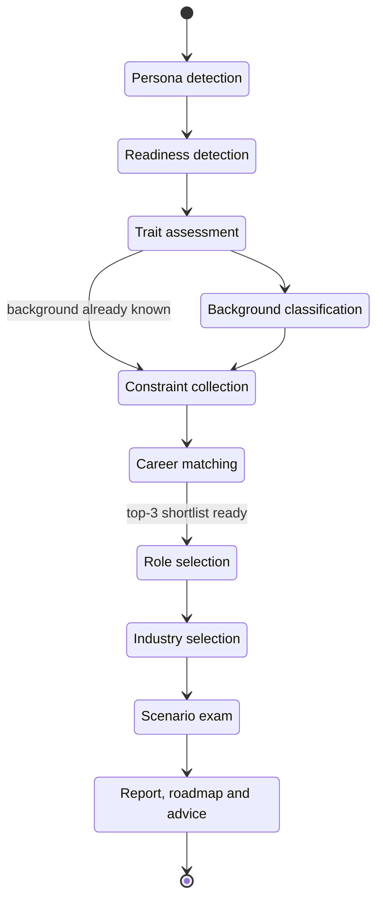

# 02 · User journey

A Dhiti session always runs through the same ten phases, in the same order. It starts as a conversation and ends with a written report. Below, each phase is described from the candidate's side: what they see, what they do, and what Dhiti is working out in the background. The links go deeper into how each part works.

If you'd rather see it for yourself, you can go through a session at **[www.dhiti.ai](https://www.dhiti.ai)**.

## The phases at a glance

## How the candidate replies

There are three ways to answer at any point in the session. The quickest is to tap one of the suggested replies. Every assistant message comes with its own set, and they're always plausible answers to *that* message, never generic filler. The candidate can also type whatever they like, or dictate by voice using the browser's speech recognition. When recognition restarts mid-answer, any words it repeats are de-duplicated.

## Phase by phase

### 1. Persona detection

The session opens as an ordinary conversation. From it, Dhiti works out which of four personas the candidate fits best: Career Discovery, Career Validation, Career Transition, or Reinvention & Independence. The [Taxonomy reference](12-taxonomy-reference.md#personas) describes each one.

### 2. Readiness detection

Next, Dhiti asks up to two questions to find out how urgent things are. The answer puts the candidate at one of four levels:

- just exploring
- planning for the next 6–12 months
- needing to move within 1–3 months
- in a crisis right now

From here on, the tone and the plan both follow that level. A candidate in crisis gets one steady next step, not a list.

At the same time, Dhiti classifies the candidate's emotional state as one of six: confusion, fear, burnout, ambition, curiosity or pressure. It uses that to set its tone, but it never tells the candidate which state it picked.

### 3. Trait assessment

This is the heart of the conversation, and it's where the 18 traits get scored. Every trait gets at least one question. It starts with curiosity and leaves setbacks until the end. After that, follow-up questions go to whichever traits still have the weakest evidence. The questions are written from what came up in the persona and readiness conversation, so they refer to the candidate's actual situation. While this is happening, a **live trait radar** fills in on screen. The details are in [Trait assessment](04-trait-assessment.md).

### 4. Background classification

Dhiti needs two more facts: whether the candidate comes from a tech or non-tech background, and whether they're a fresher or experienced. Often they've already said so in passing. When that happens, an LLM check picks it up from the conversation and the question is skipped.

### 5. Constraint collection

Three quick multiple-choice questions cover the practical side of the candidate's life:

- weekly hours available
- financial dependency (whether others rely on the candidate's income)
- relocation flexibility

### 6. Career matching

Now Dhiti puts it all together. A four-step pipeline scores all 6 families of work, then scores the roles inside the strongest families, then checks those roles against the candidate's constraints, and finally builds a personalised role map.

All of this runs on the server. On screen, an animated **career map** of the six families moves stage by stage, with camera zoom, as each step lands. Closing the tab doesn't stop it. And if the candidate goes back and changes a constraint answer, a fresh run takes over. See [Career matching pipeline](05-career-matching-pipeline.md) for how it works.

### 7. Role selection

The candidate chooses one of their top 3 roles. If they can't decide, they can pick **"I'm not sure"**. The exam is then split as evenly as possible across all three roles, and whichever role they score best on becomes the basis for the roadmap.

This screen appears as soon as the shortlist exists. It doesn't wait for the slower step that writes the personalised role details.

### 8. Industry selection

Next comes the industry, chosen from 16. "I'm not sure" is an option here too. The candidate then gets the scenarios in their generic, industry-neutral form.

### 9. Scenario exam

Before the exam starts, a "Before you begin" screen explains the format and counts down 30 seconds. The 60-minute clock starts when the candidate clicks Start, or automatically when the countdown runs out.

There are 25 scenarios. Each one either asks the candidate to "pick the best option" or to "select exactly N". Once the exam is scored, they can go back through every scenario and see the correct answer, along with a rationale for every option. [Scenario exam engine](06-scenario-exam-engine.md) covers how the exam is built and scored.

### 10. Report, roadmap and advice

The report streams in as it's written. It covers:

- state of mind
- trait interpretation
- a fit analysis or a comparison of options
- a three-phase roadmap
- what was ruled out
- an AI-resilience summary
- exam results

The candidate can export it to PDF or have the results emailed to them. After that the conversation stays open, so they can keep talking with Dhiti. More in [Report and roadmap](07-report-and-roadmap.md).

## Throughout the session

A few things are available from start to finish:

- A **stage rail** lets the candidate move between stages, look back at their history and review past sessions.
- There are **light and dark themes**.
- If the candidate wanders off mid-session, a **tab-away warning** kicks in: the tab title flashes, and they can opt in to a system notification as well.
- **In-app feedback** is always there if they want to say something.
- A session expires after 2 hours of inactivity.
