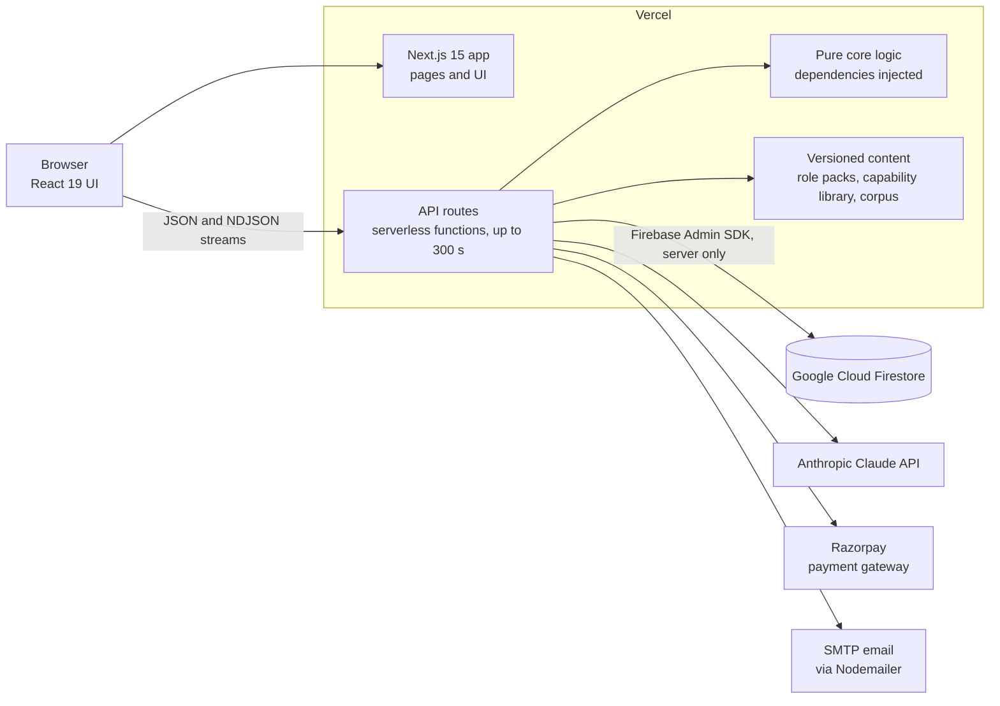

# 03 · System architecture

Dhiti is a Next.js 15 application hosted on Vercel. The browser only ever talks to the app's own server routes, which run as serverless functions and handle all data access, LLM calls, payments and email. Underneath those routes, the core logic is written as pure modules that have their dependencies passed in, with a thin server layer around them doing the I/O.

## Components

| Component | What it does |
|---|---|
| **Browser** | The React 19 interface: chat, live trait radar, animated career map, exam and report. It holds no database credentials and never receives the exam's answer key before the candidate answers. |
| **Next.js app** | App Router pages and UI, built with TypeScript, Tailwind CSS 4, Framer Motion, GSAP and Chart.js. |
| **API routes** | Next.js API routes running as Vercel serverless functions. Long-running routes can run for up to 300 s. Any route that reads or writes user data checks the signed-in user, and every paid, LLM-backed route also requires a valid paid session owned by the caller. |
| **Pure core** | Pipeline orchestration, quota maths, session activity, metrics aggregation, LLM pricing and email validation, all written as pure modules. The database, the LLM and quota checks are passed in, so the core can be unit-tested without any of them. |
| **Versioned content** | Role packs, the capability library and the knowledge corpus are JSON files in version control, not database rows. |
| **Firestore** | Google Cloud Firestore, reached **only from the server** through the Firebase Admin SDK. Browsers have no direct access. |
| **Claude API** | Anthropic Claude. Claude Sonnet 4.6 handles every LLM call in the assessment. |
| **Razorpay** | Payments. The amount charged always comes from prices computed on the server. |
| **SMTP email** | Nodemailer. Sign-up codes go out from a dedicated, authenticated domain mailbox that's kept separate from operational email. |
| **Auth** | NextAuth.js, with email and password or Google sign-in. |

## Why the database is closed to browsers

Login goes through NextAuth, not the database's own auth system. That means the database has no browser identity it could write access rules against. So instead, every read and write goes through a server route that checks the signed-in user. A useful side effect is that sensitive data, like the exam's answer key, never has to leave the server. There's more on this in [Security, privacy and integrity](09-security-privacy-integrity.md).

## Request lifecycle

Here's what happens to a paid, LLM-backed request, step by step:

1. The route confirms who the signed-in user is.
2. It checks that the user owns a valid paid session for this assessment.
3. It checks the session's LLM call ceiling for this kind of work, which is one of scenario generation, trait questions, chat turns, scoring or report. These are abuse ceilings set several times above real use, not throttles ([more on ceilings](08-reliability-cost-performance.md#per-session-llm-call-ceilings)).
4. The thin server layer calls the pure core, passing in the database, the LLM client and the quota checks.
5. The result goes back as JSON, or as a stream for long-running work.
6. Once the response has been sent, the route records the LLM call's step label, model, tokens, computed cost, latency and outcome. Because this happens afterwards, it adds no latency for the candidate.

## Long-running work

Two parts of a session take much longer than a normal request. Both are built to finish even if the browser goes away.

| Work | How it runs | Details |
|---|---|---|
| **Career matching** | One server-side run of four steps. Each step's result streams to the browser as a newline-delimited JSON (NDJSON) event and is saved as a checkpoint. The run keeps going after the response is sent. A reload joins the run that's already in progress, and a newer run takes over from an older one. | [05](05-career-matching-pipeline.md) |
| **Exam generation** | 25 scenario rewrites run in parallel, under a 250 s budget that fits inside the platform's 300 s limit. A lock makes sure each session gets only one generation. | [06](06-scenario-exam-engine.md), [08](08-reliability-cost-performance.md) |

The final report streams to the browser too, as it's generated, and is saved once it's complete.

## Session model

**One credit is one assessment session.** A session expires after **2 hours** of inactivity. Its last-activity timestamp is written at most **once every 60 seconds**, rather than on every answer.

Pipeline checkpoints, the generated exam and the final report are each saved as they complete, and the generation lock is stored with the session. That's what lets a reload pick up where the candidate left off.

## Content as data

Role packs, the capability library and the knowledge corpus all live as JSON in version control, so every content change shows up as a reviewable diff. Offline scripts batch-generate content and clean up phrasing. One cleanup across the whole bank replaced templated phrasing in the seed scenarios. Whatever the scripts produce or rewrite has to pass the same validation as live generation before it's merged.

## Operations

Operators work from an admin panel with six tabs:

- **Overview**: LLM cost, tokens and latency per pipeline step, plus daily metrics, weekly cohorts and payment reconciliation
- **Users**
- **Coupons**
- **Completions**: the full report for any completed assessment
- **Feedback**
- **Leads**: enquiries from colleges and enterprises

## See also

- [Tech stack](10-tech-stack.md)
- [Engineering decisions](11-engineering-decisions.md)
