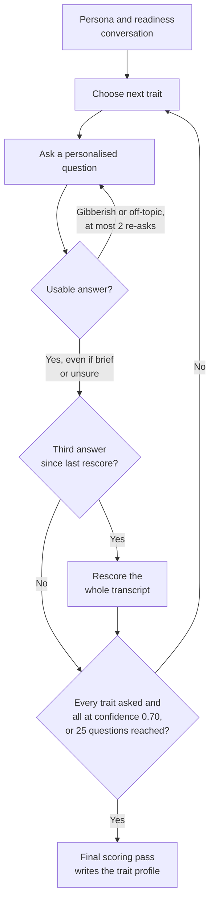

# 04 · Trait assessment

Dhiti scores the candidate on 18 traits through a conversation that adapts as it goes, rather than through a questionnaire. Every trait gets one guaranteed question. After that, follow-ups go to whichever traits have the weakest evidence, until the evidence is strong enough or the session reaches 25 questions. Each score comes with a confidence level and a few short pieces of evidence taken from what the candidate actually said.

## What a trait score contains

Each of the 18 traits (they're listed in the [Taxonomy reference](12-taxonomy-reference.md#traits)) is scored on three things:

| Part | Range | Purpose |
|---|---|---|
| **Score** | 0–100 | How strongly the trait showed up. |
| **Confidence** | 0–1 | How much evidence the answers gave. Thin evidence means softer language in the report. |
| **Signals** | 1–4 per trait | Short pieces of behavioural evidence, written in the second person and quoting what the candidate actually said. |

A signal reads like *"You described restarting the project within days of cancellation"*, never like *"User showed resilience"*. Writing them this way ties each score to a moment the candidate will recognise from their own story.

## How the conversation flows

### Seed phase: one guaranteed question per trait

Every trait gets one question to start with. The order isn't random. It follows a deliberate arc:

1. **Curiosity**: something the candidate went deep on by choice
2. **Analytical and problem-solving** traits
3. **Execution and achievement** traits
4. **Interpersonal** traits
5. **Adaptability and resilience**, last

Starting with curiosity means the first thing the candidate talks about is something they chose to care about. Setback questions come at the end, because they land better once there's some rapport.

### Adaptive phase: follow up where evidence is weakest

Once the seed questions are done, follow-ups go to the traits with the weakest evidence. The session **caps at 25 questions**. It **ends early** once every trait has been asked about **and** all traits have reached a **confidence of 0.70**.

In practice, a candidate who gives rich answers finishes sooner, and one who gives brief answers gets more chances to show what they can do.

### Personalised questions

The questions are written from the persona and readiness conversation. So they refer to the candidate's actual situation, instead of reading like a generic test item.

## Scoring

Every **3 answers**, the whole transcript is rescored, not just the latest answer. That's how confidence builds up over the conversation, and how the adaptive phase knows which traits are still thin.

At the end, a final scoring pass writes the trait profile. It contains:

- scores for all 18 traits
- the dominant and weak traits
- a short, warm-but-honest summary that describes the person rather than listing trait names

## Handling non-answers

Short, unsure and half-formed answers are real answers. Dhiti is there to keep the conversation going, not to grade how well someone writes. Non-answers get caught in two tiers:

| Tier | What it catches | Cost |
|---|---|---|
| **1. Heuristic** | Keyboard-mashing: no vowels, repeated short chunks, symbols only | Free, with no LLM call |
| **2. Relevance check** | Clearly off-topic answers, judged by a lenient LLM check | One LLM call, made only if tier 1 passes |

A partial or brief answer, or an "I don't know", still counts as relevant. No question is re-asked more than **2 times**. And when a question turns out to be hard to follow, Dhiti can rephrase it more simply.

## Problems this design solves

| Problem | How the design responds |
|---|---|
| Fixed questionnaires spend the same effort on every trait, however much is already known about it. | Every trait gets one seed question, and later questions go only to the traits with the weakest evidence. |
| A single score can sound more certain than the evidence allows. | Every score carries a confidence level, and the report softens its language when evidence is thin ("you showed signs of"). See [ADR-12](11-engineering-decisions.md#adr-12-use-honest-confidence-everywhere). |
| Asked too early, questions about failure put people on the defensive. | The seed order saves adaptability and resilience for last. |
| Strict relevance checks punish people who are unsure or brief. | The relevance check is lenient, "I don't know" counts, and re-asks are capped at 2. |
| Running an LLM check on every answer costs money. | A free heuristic runs first, and the LLM check only runs if it passes. |
| Hand-maintained trait tables drifted apart, and the report showed the wrong labels. | Every trait comes from one canonical registry. See [ADR-09](11-engineering-decisions.md#adr-09-one-canonical-trait-registry). |

## See also

- [Career matching pipeline](05-career-matching-pipeline.md): how trait scores feed into role matching
- [Report and roadmap](07-report-and-roadmap.md): how the trait profile shows up in the report
