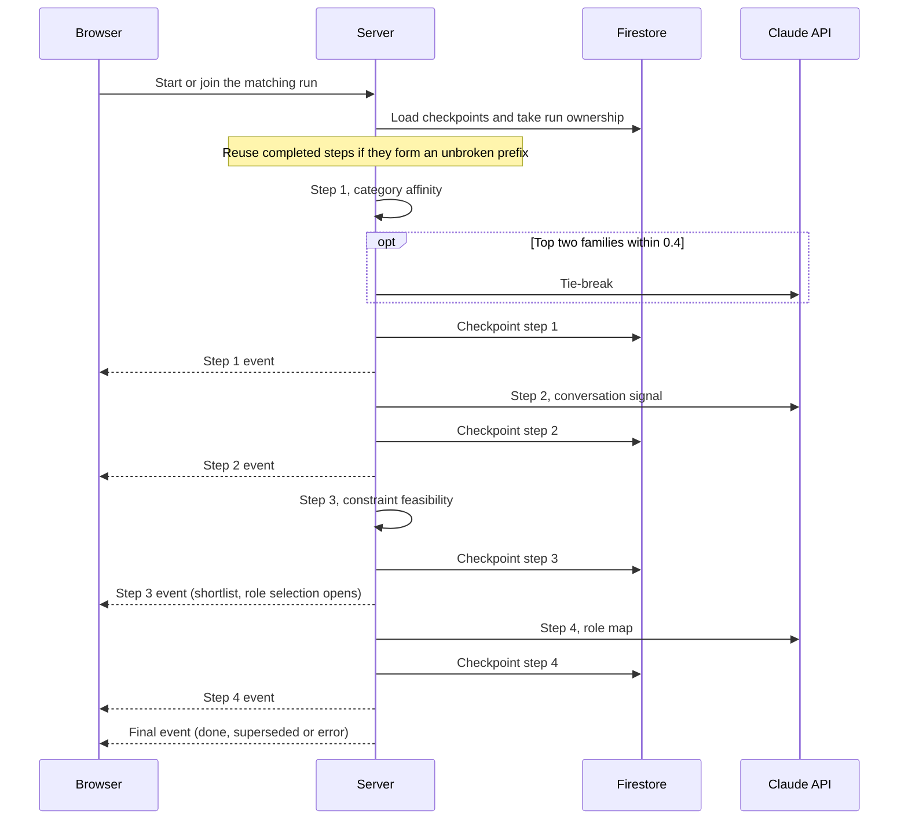

# 05 · Career matching pipeline

Career matching takes the trait profile, the conversation and the candidate's constraints, and narrows 30 roles down to a shortlist of three. It works in four steps. First it scores the families of work, then the roles inside the best two families. Next it checks those roles against the candidate's constraints, and finally it enriches the three that are left. All of it runs on the server as one request. Each step's result is streamed to the browser and saved as a checkpoint, so the run survives a closed tab and picks up again after a reload.

## The four steps

| Step | What it does | LLM? | Passes on |
|---|---|---|---|
| **1. Category affinity** | Scores all 6 families of work from the trait scores | Only to break near-ties | Top 2 families |
| **2. Role signal score** | Scores every role in those two families on trait fit and conversation signal | 1 call | Top 5 roles |
| **3. Constraint feasibility** | Scores each role's transition path against the candidate's life, and rules out roles that clearly don't fit, giving reasons | No | Top 3 roles |
| **4. Role map** | Enriches the top 3 with static and personalised content, plus a goal-alignment check | 1 call | The final shortlist |

The exact weights are tuned and aren't published. What follows is the method.

### Step 1: Category affinity

Each of the **6 families of work** is a weighted blend of **6 of the 18 traits**, with weights that add up to 1. That gives every family a score on a 0–10 scale. A small adjustment based on the candidate's persona comes next, and then the **top 2 families** go forward.

Sometimes the top two are close. If they're within **0.4 points** of each other, Claude reads the conversation summary and decides which one ranks first. If they aren't that close, this step makes no LLM call at all.

All six families get scored, even though only two go forward. That's what lets the report explain later which families weren't recommended, and why.

### Step 2: Role signal score

Every role in the top two families gets a score:

```
final = 0.6 × trait fit + 0.4 × conversation signal
```

**Trait fit** is a weighted match between the candidate's traits and the **5–6 traits** that matter most for that role. **Conversation signal** comes from a single Claude call that rates all the candidate roles together against what the candidate actually talked about. The **top 5** roles go forward.

### Step 3: Constraint feasibility

This step is pure maths, with no LLM involved.

Every role has a typical *transition path*, meaning what it usually takes to move into that role. The path is scored against the candidate's life on **6 dimensions**:

- time
- financial risk
- risk appetite
- learning intensity
- relocation
- family impact

The candidate's side of the comparison comes from their three constraint answers: weekly hours available, financial dependency and relocation flexibility. Comparing the two gives a feasibility score, which then adjusts the role score:

```
constrained score = role score × feasibility / 10
```

Roles that clearly don't fit are **eliminated, with a stated reason**. That reason shows up in the report's "What was ruled out" section, framed as a matter of constraints and not as the role being lesser. The **top 3** roles go forward, and they're the shortlist the candidate chooses from.

### Step 4: Role map

The last step fills in the top 3 roles with two kinds of content.

| Static (from the versioned role content) | Personalised (from Claude) |
|---|---|
| Description of the role | Fit rationale |
| Why the role resists AI automation | Strengths it draws on |
| A 3-stage growth path | Skill gaps |
| An entry point | Key actions |
| | Effort level |
| | Transition timeline |

The same call also runs a **goal alignment** check. It compares what the candidate said they wanted with what the pipeline actually surfaced, and gives a status of **match**, **partial** or **mismatch**, along with an explanation. Where the two differ, the explanation spells out how.

## How the pipeline runs



Steps 1–4 run on the server as a single request. As each step finishes, its result streams to the browser as a newline-delimited JSON (NDJSON) event, and the career map moves forward one step. The run doesn't depend on the browser staying open. It keeps going after the response has been sent, so closing the tab doesn't stop it.

Each step's output is saved as soon as it completes. When a session resumes, it reuses the completed steps as long as they form an unbroken prefix (step 1, or steps 1–2, and so on), and only computes what's missing. A reload joins the run that's already in progress instead of starting a second one.

Runs also have a clear owner. If the candidate goes back and re-answers a constraint question, a newer run takes over and the older one stops writing. Either way, the stream always ends in exactly one of `done`, `superseded` or `error`.

One detail makes a noticeable difference to the wait. The shortlist already exists once step 3 completes, so role selection opens at that point. Step 4 is the slow LLM enrichment, with a median duration of 45.7 s across 83 runs, and it carries on in the background while the candidate decides. See [result 3](13-results-and-measurements.md#result-3-role-selection-wait).

## Why it runs on the server

It didn't always. The browser used to chain the four steps as four separate requests. If the candidate closed the tab, the chain simply stopped. Worse, an error from one step could be passed on as if it were the next step's input. Moving the orchestration to the server gave each run checkpoints, the ability to resume, a stream of progress events and exactly one owner at a time. The trade-off is that the server now owns a long-lived request. See [ADR-04](11-engineering-decisions.md#adr-04-move-pipeline-orchestration-from-the-browser-to-the-server).

The orchestration logic itself is a pure module, with the database, the LLM and quota checks passed in. Its tests cover orchestration, checkpoint reuse, supersession, quota refusal, the streaming event protocol and the pipeline state reducer. See [Tech stack](10-tech-stack.md#testing).

## See also

- [Trait assessment](04-trait-assessment.md): where the trait scores come from
- [Report and roadmap](07-report-and-roadmap.md): how the shortlist and the eliminations appear in the report
- [Taxonomy reference](12-taxonomy-reference.md#families-of-work-and-roles): all 6 families and 30 roles
