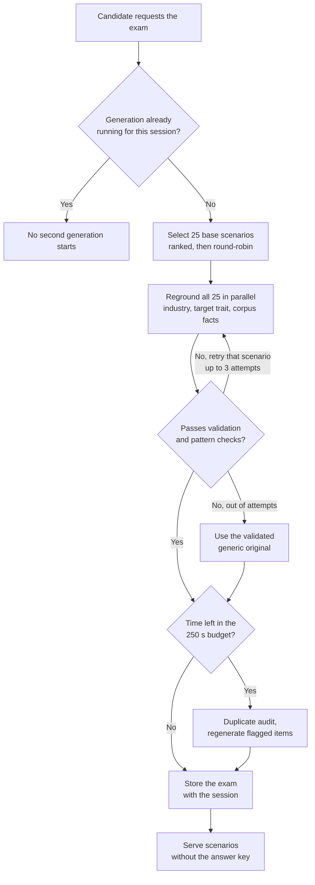
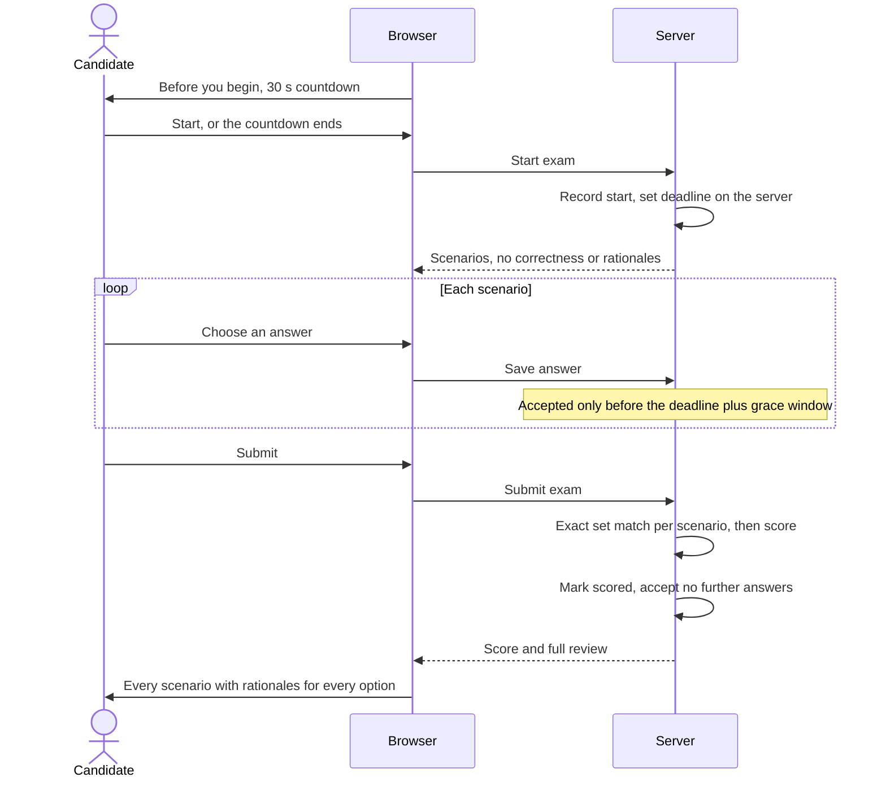

# 06 · Scenario exam engine

The exam tests the candidate on the real work of the role they picked: 25 workplace scenarios, on a 60-minute clock. The scenarios are picked for each candidate from a hand-authored bank of 900. Claude then rewrites them into the industry the candidate chose, and checks in code make sure the rewrite can't change which answers are correct. Scoring is deterministic, and the answer key never leaves the server.

> This page explains how the exam is built and run. It doesn't contain any exam content. Publishing scenarios, options or rationales would let candidates prepare for the exact questions.

## The question bank

| Property | Value |
|---|---|
| Size | **900** scenarios: 30 roles × 30 situations each |
| Scenario categories | **6 per role** (180 in total), each a family of decisions |
| Difficulty tiers | **3**: foundation, intermediate, advanced (roughly a third each) |
| Answer options | **4–6** per scenario |
| Formats | **Single-select** ("pick the best option") or **multi-select** ("select exactly N"), like a professional certification exam |
| Capability mapping | Each scenario maps to capabilities in a shared library of **48 capabilities across 8 "intelligence" domains** |

Every scenario was written by hand and validated, and each one asks a single question. A scenario is made up of:

- the professional context
- the main problem
- the stakeholders
- the information available
- the constraints
- the uncertainties
- the task
- the answer options, each with a rationale

Role packs, the capability library and the knowledge corpus are kept as versioned JSON in source control. Any change to content shows up as a reviewable diff, and every generated or rewritten item has to pass the same validation as live generation before it's merged. See [System architecture](03-system-architecture.md#content-as-data).

## Choosing the candidate's 25

The 25 scenarios aren't drawn at random. They're picked for this particular candidate, by ranking situations on four things:

- **Trait gaps.** How strongly a situation's capabilities overlap with the candidate's **weakest or unscored traits**.
- **Difficulty mix.** This depends on how well the candidate's traits fit the role. A strong fit sees more advanced judgment calls. The fit used here is measured *before* constraints, so a candidate who's short on time but a strong fit still gets hard content (see [ADR-10](11-engineering-decisions.md#adr-10-set-difficulty-from-pre-constraint-fit)). The candidate's **experience level** then nudges the mix.
- **Wording.** A gentle nudge on how technical the wording is, based on the candidate's background.
- **Some randomness.**

A round-robin then draws from the ranked situations. The most relevant situations end up contributing the most, but every one still gets a look. The selection weights are tuned and aren't published.

**If the candidate chose "I'm not sure" at role selection,** the 25 scenarios are split as evenly as possible across their top 3 roles. Each role is scored on its own. The best-scoring role becomes the basis for the roadmap, and a tie goes to the role's original rank.

## Live regrounding

When the candidate asks for the exam, each of the 25 base scenarios is rewritten just for them. Claude Sonnet moves the scenario into the **chosen industry**, and aims it at the **specific trait** the candidate most needs to be tested on for that category. The rewrite is grounded in facts from a small knowledge corpus.

If the candidate said "I'm not sure" when choosing an industry, there's nothing to move. They get the scenarios in their generic, industry-neutral form.

### The corpus: no vector database

The corpus is **46 packs** (30 role packs and 16 industry packs), about **1,100 chunks** in total. That's small enough that the relevant packs go **straight into the prompt**. There's no vector database, no embeddings and no retrieval misses. The retrieval layer sits behind a small interface, so if the corpus ever grows a lot, it can be swapped out. See [ADR-01](11-engineering-decisions.md#adr-01-inject-retrieval-directly-instead-of-using-a-vector-database).

### Correctness is locked

The LLM can change the *setting*, but it can't change *which answers are correct*. Code checks every rewrite before accepting it:

| Check | Rule |
|---|---|
| Identity | IDs are unchanged |
| Format | Answer format and select count are unchanged |
| Options | 4–6 options, each with non-empty text and a rationale |
| Answer key | **Which options are correct can't move** |
| Consistency | The number of correct options equals the select count |

There are also pattern checks that reject lazy, repetitive shapes. Examples are a formulaic "Your organisation is a…" opener, a bare "Decide how…" task, or a stakeholder given only as a name and a title.

### Retries, fallback and the duplicate audit

All 25 rewrites run at the same time. If one fails, it's retried, up to 3 attempts in total. If it still fails after that, the candidate gets that scenario's original, validated generic version. **A failed LLM call never blocks a candidate.**

Once regrounding is done, one more pass looks across the whole batch for near-duplicates and regenerates any it flags.

### Exam generation flow



### Time budget

Serverless functions on the platform have a hard **300 s** limit. Hitting it means the function is killed outright, with no graceful stop. So the generation route works to a **250 s** budget instead:

| Phase | Status |
|---|---|
| Selection and regrounding (with fallback) | **Mandatory.** |
| Duplicate audit and regeneration | **Best-effort.** Skipped if there isn't time. |

The candidate always gets their exam. Here's the measured effect of this budget combined with the concurrency change ([results 1 and 2](13-results-and-measurements.md#result-1-exam-generation-time)):

> **Exam generation 53% faster in the worst case and 27% faster at p90.** Raising regrounding concurrency from 10 to 25, plus the 250 s time budget, took worst-case generation time from **399 s to 189 s** and p90 from **259 s to 189 s**. The median moved from 147 s to 137 s. *Measured from production session timestamps, from role selection to scenarios ready: 36 runs before, 8 runs after. A small sample after the change.*
>
> **Runs exceeding the 300 s serverless limit went from 3 of 36 to 0 of 8.** *Same small sample. Some of the slow early runs may have been in local development, which has no such limit.*

### One generation per session

A generation lock, stored with the session, stops a second request from kicking off another generation while one is already running. The lock expires after a period matched to the platform's maximum function duration. Duplicate generations used to be the single biggest avoidable LLM cost ([result 5](13-results-and-measurements.md#result-5-llm-cost-per-assessment-estimate)):

> **About 30% lower LLM cost per assessment (an estimate).** This comes mainly from the generation lock stopping duplicate scenario generations. *Modelled from token counts and list prices, not from billing data.*

## Taking the exam



### The clock

The candidate gets **60 minutes**, starting when they click Start. If they don't click, the 30-second "Before you begin" countdown starts the clock for them.

**The deadline is set by the server**, so starting late shortens the exam rather than extending it. There's also **a generous grace window**, so an honest candidate whose tab drifted into the background isn't penalised.

### Scoring

Scoring is deterministic, and no LLM is involved. A scenario counts as correct only if the selected set **exactly matches** the correct set. There's **no partial credit** on "select N" questions, the same as in real certification exams. The overall score is:

```
overall score = correct / total × 5
```

The exam is **scored once**. That score is final, and no further answers are accepted after it.

Exact set matching gives instant, reproducible results. There's no LLM grader to drift and no LLM spend at scoring time, and it makes a full rationale review possible. See [ADR-02](11-engineering-decisions.md#adr-02-deterministic-multiple-choice-scoring-instead-of-an-llm-grader).

### Review

After scoring, the candidate can go back through every scenario. They see the full situation, their own answer, the correct answer, and a rationale for **every** option, not only the correct one.

### Focus tracking

Dhiti records how many times the candidate left the exam tab, as soft integrity metadata. It is **not** used in scoring.

## Regulated roles

Scenarios for **clinical psychologist** and **wellness coach** are deliberately narrow in scope. They test professional, ethical and practice-management judgment, using only fictional, de-identified cases. Results are never presented as clinical competence, licensure or certification.

## See also

- [Reliability, cost and performance](08-reliability-cost-performance.md): concurrency, the time budget and the generation lock in more depth
- [Security, privacy and integrity](09-security-privacy-integrity.md#exam-integrity)
- [Report and roadmap](07-report-and-roadmap.md): how exam results feed into the report
