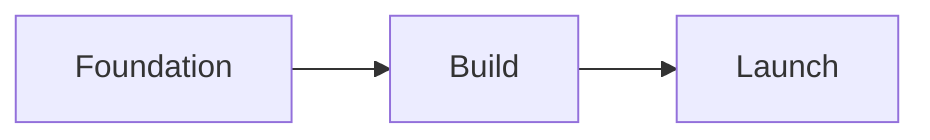

# 07 · Report and roadmap

Everything in the session leads up to the written report. It covers where the candidate is now, what their traits suggest, which roles fit and why, how they did on the real work, what was ruled out, and a three-phase roadmap. The report streams in as it's being generated and is saved once it's complete. The candidate can export it to PDF or have it emailed to them.

## What the report contains

| Section | What it contains |
|---|---|
| **State of mind** | Where the candidate is right now, drawing on how urgent things are for them, their emotional state and the conversation. The classified emotional state shapes the tone, but its label is never shown. |
| **Trait interpretation** | Dominant and developing traits, plus a summary. The wording follows confidence: where evidence is thin, it says "you showed signs of" rather than "you are". |
| **Persona insights** | The candidate's persona, including their tech background and experience level. |
| **Fit analysis** *or* **comparative recommendations** | One or the other, depending on how sure the candidate was (see below). |
| **Future roadmap** | A three-phase plan for the primary role: Foundation → Build → Launch. |
| **What was ruled out** | Eliminated roles and families of work, and why. |
| **AI-resilience summary** | What AI is likely to handle in the field, and what it can't. |
| **Exam results** | How they did on the 25 scenarios, including the topics they missed. |

## Fit analysis or comparison

The middle of the report changes depending on whether the candidate knew what they wanted.

| Candidate was… | Report shows |
|---|---|
| **Sure of both role and industry** | A **fit analysis** of the chosen role, grounded in their actual exam performance (for example "18/25 correct (72%)"), with strengths shown and areas to develop |
| **Unsure** | **Comparative recommendations** across the top options, each with a fit rationale, a score and short keyword tags |

If the candidate wasn't sure about the role, the exam was split across their top three roles, and each role was scored on its own. Whichever role scored best becomes the primary role for the roadmap. If two tie, the one that ranked higher originally wins. See [Scenario exam engine](06-scenario-exam-engine.md#choosing-the-candidates-25).

## The roadmap

The roadmap is for the primary role, and it's split into three phases.

For each phase, the candidate sees a **duration**, a **focus**, **milestones** and the **weekly hours required**. On top of that, the roadmap gives **next steps for the first 30 days**, the **total timeline** and an **effort level**.

Like everything else in Dhiti, the tone and the plan adapt to how urgent things are. A candidate in crisis gets one steady next step, not a list (see [Product overview](01-product-overview.md#product-principles)).

## What was ruled out

Because every family of work gets scored, the report can explain what wasn't recommended. It lists the eliminated roles and families, each with a reason. The framing is always about the candidate's profile and constraints, never about those roles being lesser. Eliminations based on constraints come from step 3 of the [career matching pipeline](05-career-matching-pipeline.md#step-3-constraint-feasibility).

## How it's built

The report streams to the browser as it's generated, and it's saved once generation finishes. Like every other call in the assessment, it's written by Claude Sonnet 4.6. Report generation has its own per-session call ceiling, set well above what real use needs (see [Reliability, cost and performance](08-reliability-cost-performance.md#per-session-llm-call-ceilings)).

When the report is done, a print-optimised layout turns it into a PDF, and the results can be emailed to the candidate. The conversation doesn't end there, either. The candidate can keep talking with Dhiti afterwards.

## See also

- [Trait assessment](04-trait-assessment.md): where the trait interpretation comes from
- [Career matching pipeline](05-career-matching-pipeline.md): where the roles and eliminations come from
- [Scenario exam engine](06-scenario-exam-engine.md): where the exam results come from
